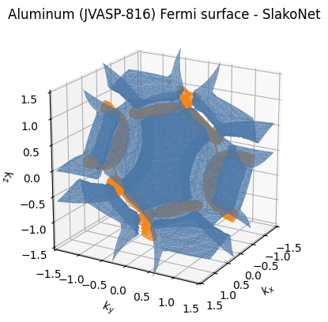

# sk-fermisurf

Standalone 3D Fermi-surface plotting. Two front-ends feed one isosurface + plotting
core, producing an interactive Plotly HTML you open in any browser. No web service and
no credentials, just standalone Python scripts.

- **SlakoNet** (Slater-Koster tight binding): sample band energies on a full Brillouin-
  zone grid with a SlakoNet model, then marching-cubes the E = E_F isosurface of every
  band that crosses the Fermi level.
- **VASP**: read a uniform-mesh `vasprun.xml`, Fourier-interpolate, and extract the
  Fermi surface with [IFermi](https://fermisurfaces.github.io/IFermi/).

## Install

```bash
pip install -r requirements.txt     # numpy scipy scikit-image plotly pymatgen ifermi jarvis-tools
# SlakoNet route additionally needs the `slakonet` package + torch
```

## Worked example: Aluminum (JVASP-816)

One command builds the aluminum Fermi surface from JARVIS-DFT with the SlakoNet model:

```bash
python -m fermisurf.slakonet_fermi --jid JVASP-816 --nk 24 --out Al_fermi.html
# -> E_F = -0.002 eV | grid 24^3 | wrote Al_fermi.html
```

This is the nearly-free-electron aluminum Fermi surface (the 2nd-band sheet plus the
3rd-band corner arms), comparable to the reference images at
[hzdr.de/projects/fermisur](https://www.hzdr.de/projects/fermisur/al.html). Open
`Al_fermi.html` in a browser to rotate it; a pre-built copy is in
[`examples/JVASP-816_Al_fermi.html`](examples/JVASP-816_Al_fermi.html).



Two notebooks walk through the full workflow:

- [`examples/slakonet_fermi_surface.ipynb`](examples/slakonet_fermi_surface.ipynb) -
  SlakoNet tight-binding surfaces for Al, Nb, Mg, Ti (runs out of the box).
- [`examples/jarvis_dft_fermi_surface.ipynb`](examples/jarvis_dft_fermi_surface.ipynb) -
  the quantitative DFT route: a JARVIS-DFT structure + a static VASP run -> IFermi.

The Fermi level is set from band filling (valence-electron count), self-consistently
with the eigenvalue spectrum.

## SlakoNet route

```bash
python -m fermisurf.slakonet_fermi --poscar POSCAR --nk 24 --out fs.html
python -m fermisurf.slakonet_fermi --jid JVASP-1002 --nk 24 --out fs.html
```

- `--nk` sets the Monkhorst-Pack grid density per axis (denser = smoother surface, more
  compute); 20-30 is a good range.
- `--model PATH` uses a specific SlakoNet model (default: the bundled one).
- Runs on CPU by default (`--device cuda` to use a GPU). Each k-point is a small
  eigenproblem, so a dense grid is still cheap.

Programmatic use:

```python
from jarvis.core.atoms import Atoms
from fermisurf.slakonet_fermi import eigenfield
from fermisurf.isosurface import fermi_surface_figure, save

atoms = Atoms.from_poscar("POSCAR")
field, efermi, cell = eigenfield(atoms, nk=24)      # (nx,ny,nz,nbands) eV, E_F, cell
fig = fermi_surface_figure(field, efermi, cell)
save(fig, "fs.html")
```

## VASP route

Run a static VASP calculation on a dense, non-symmetry-reduced k-mesh (`ISYM=0`), then:

```bash
python -m fermisurf.vasp_fermi --vasprun vasprun.xml --out fs.html
python -m fermisurf.vasp_fermi --vasprun vasprun.xml --mu 0.1 --interpolation-factor 8
```

`--mu` shifts the isosurface to `E_F + mu` (eV); `--interpolation-factor` controls the
Fourier interpolation density.

## Files

| File | Role |
|---|---|
| `fermisurf/isosurface.py` | marching-cubes isosurface extraction + Plotly 3D rendering (shared) |
| `fermisurf/slakonet_fermi.py` | SlakoNet band energies on a BZ grid + CLI |
| `fermisurf/vasp_fermi.py` | VASP Fermi surface via IFermi + CLI |

The SlakoNet energies/Fermi level come from the model; the scripts handle the k-grid,
isosurface extraction, reciprocal-space mapping, and plotting.
